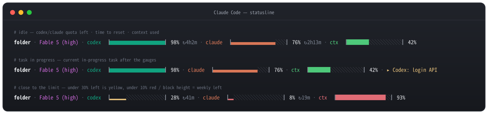

# claude-statusline

[English](README.md) · **한국어**

Claude Code 하단에 Claude/Codex 사용량, 컨텍스트 사용률(%), 진행 중인
태스크를 한 줄로 보여주는 상태줄. 상태줄 자체의 표시는 영어입니다.



## 설치

```bash
curl -fsSL https://raw.githubusercontent.com/zoo3323/claude-statusline/main/install-claude-statusline.sh | bash
```

설치 후 Claude Code를 재시작하면 상태줄이 나타납니다. `jq`가 없으면 관리자 권한
없이 `~/.local/bin`에 받아옵니다. 설치되는 건 `~/.claude/scripts/`의 스크립트,
`/refresh` 스킬, `~/.claude/codex-status/` 캐시, `~/.local/bin/cu-refresh`
링크입니다.

Claude Code는 열려 있는 모든 세션에서 상태줄을 1초마다 다시 실행하고, 그 사이에
메모리에 남는 것은 없습니다. 표시할 내용이 바뀌지 않는 동안에는 다른 프로그램을
하나도 띄우지 않고 직전에 그린 줄을 다시 내보내며, 빛도 그 위에 덧그립니다(M
시리즈 맥에서 한 번에 3~4ms). 숫자가 바뀔 때 필요한 전체 렌더는 약 15ms입니다.

## 사용량 게이지 읽는 법

| 요소 | 의미 |
| --- | --- |
| 바 길이 | 5시간 창에서 남은 비율 |
| 블록 높이 `▁▂▃▄▅▆▇█` | 주간 한도에서 남은 양 |
| 색 | 남은 양 30% 미만이면 노랑, 10% 미만이면 빨강 |
| `↻1h23m` | 창 리셋까지 남은 시간 |

`ctx` 게이지는 반대로 움직입니다. 컨텍스트가 찰수록 채워지고, 70%를 쓰면
노랑, 90%를 쓰면 빨강이 됩니다.

지금 쓰이고 있는 한도는 모든 세션의 게이지에 표시됩니다. 한도는 계정 단위라서
어느 세션이 쓰든 마찬가지입니다. 이 머신의 Claude Code 세션 중 하나라도 일하고
있으면 `claude` 게이지가, Codex 작업이 돌고 있으면 `codex` 게이지가 사용 중입니다.
직접 일하고 있는 세션에서는 게이지 위로 빛이 오른쪽에서 왼쪽으로 흐르고, 나머지
세션에서는 바 끝이 움직임 없이 밝게 빛납니다.

일하지 않는 세션에서 아무것도 움직이지 않는 것은 의도한 것입니다. 움직이는 빛은
매초 터미널 출력(약 100바이트)이 되는데, 재접속에 대비해 터미널 출력을 보관하는
연결(Eternal Terminal은 서버 메모리에 보관)은 그만큼 계속 차오릅니다. 일하는
세션은 어차피 터미널에 계속 쓰고 있습니다.

게이지 길이는 터미널 폭을 따라갑니다. 넓으면 길어지고 좁으면 짧아지며, 게이지를
그릴 자리가 없으면 숫자만 남습니다. 진행 중인 태스크는 줄의 남은 자리에 맞춰
잘립니다.

사용량은 아무것도 안 하고 있어도 갱신됩니다 — 프롬프트를 넣을 때만이 아니라
백그라운드로 조회합니다. 즉시 새로고침은 터미널에서 `cu-refresh`, Claude Code
안에서 `/refresh`. Codex 게이지는 이 머신에 Codex CLI가 로그인되어 있을 때만
나타납니다.

조회는 Claude Code와 Codex가 이미 이 머신에 저장해 둔 OAuth 토큰을 재사용해 계정
사용량을 읽습니다. 모델 요청이 아니라 계정 정보 조회라서 사용량을 소모하지 않고,
다른 어디로도 전송되지 않습니다. 두 엔드포인트 모두 공식 문서화된 API가 아니므로
오류가 오면 Claude Code가 주는 값으로 폴백합니다.

## 글자 대신 아이콘

```bash
touch ~/.claude/codex-status/icons   # 지우면 다시 글자로 돌아갑니다
```

다음 렌더부터 게이지 앞의 `codex`, `claude` 글자가 OpenAI와 Claude 로고로
바뀌고, `ctx`는 말풍선으로 바뀝니다. 모두 Nerd Fonts 글리프이고, 터미널이 그릴
수 있는지를 스크립트가 알아낼 방법이 없어서 기본값은 꺼져 있습니다. 기준은
지금 보고 있는 터미널의 글꼴입니다. SSH로 다른 머신의 Claude Code를 쓸 때도
마찬가지이고, 마커 파일은 Claude Code가 도는 머신에 만듭니다.

말풍선은 Nerd Fonts 3 글꼴이면 어디에나 있습니다. 두 로고(`U+EC81`, `U+EC82`)는
Nerd Fonts 3.5.0부터 들어갔고, *Symbols Nerd Font* 3.5 이상을 설치하면
생깁니다. 터미널이 옛 버전을 내장하고 있으면 설치한 글꼴을 쓰도록 지정해야 할
수 있습니다. Ghostty 1.3은 3.4.0을 내장하므로 설정에 다음 줄이 필요합니다.

```
font-codepoint-map = U+EC81-U+EC82=Symbols Nerd Font
```

## 제거

```bash
curl -fsSL https://raw.githubusercontent.com/zoo3323/claude-statusline/main/uninstall-claude-statusline.sh | bash
```

설치가 건드린 것만 정확히 되돌리고, 다른 설정은 그대로 둡니다.

## 개발

스크립트 원본은 `src/`에 있습니다. `install-claude-statusline.sh`는 `./build.sh`가
거기서 생성하므로, installer가 아니라 `src/`를 고쳐야 합니다. `./build.sh --check`는
커밋된 installer가 최신이 아니면 실패합니다. `./test.sh`는 네트워크를 막아 둔 임시
홈 디렉터리에서 스크립트를 돌려 검사합니다.
