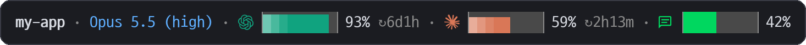
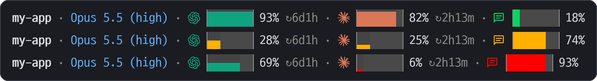
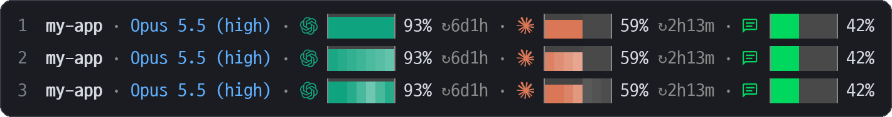
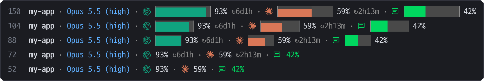
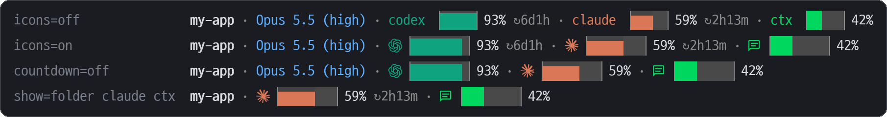

# usage-statusline

**English** · [한국어](README.ko.md)

A status line for Claude Code: how much Claude and Codex quota is left and how
full the context is.



## Install

Inside Claude Code:

```
/plugin install usage-statusline --marketplace zoo3323/usage-statusline
/usage-statusline:setup
```

Or from a shell:

```bash
curl -fsSL https://raw.githubusercontent.com/zoo3323/usage-statusline/main/install.sh | bash
```

macOS, Linux, WSL. `jq` is fetched if it is missing.

## Reading it



| | |
| --- | --- |
| bar length | 5-hour quota left |
| bar height | weekly quota left |
| yellow, red | under 30%, under 10% left |
| `↻2h13m` | time until the window resets |

The context gauge fills up instead: yellow from 70%, red from 90%. Usage is
polled in the background, so the numbers move while you are idle. The Codex
gauge needs the Codex CLI logged in.

## In use



1. Nobody is spending the quota.
2. Another session on this machine is: the bar brightens towards its end.
3. This session is: a light runs along the bar.

## Any width



The gauges shrink with the terminal, then give way to the bare numbers.

## Your choice



Run `/usage-statusline:setup` again, pass options to the script (`--help`), or
edit `~/.claude/codex-status/config`:

```
show=folder model codex claude ctx
countdown=on
icons=off
light=on
```

Icons need a terminal font with Nerd Fonts 3.5 glyphs. Ghostty 1.3 bundles 3.4:
install *Symbols Nerd Font* and add
`font-codepoint-map = U+EC81-U+EC82=Symbols Nerd Font`.

## More

- **Refresh now** — `/usage-statusline:refresh`, or `cu-refresh` in a shell.
- **Remove** — `/usage-statusline:uninstall`, or `curl -fsSL https://raw.githubusercontent.com/zoo3323/usage-statusline/main/uninstall.sh | bash`.
- **Cost** — an idle session replays its last line: about 3 ms a second, no other
  process, nothing kept in memory.
- **Privacy** — usage is read with the tokens Claude Code and Codex already keep
  on your machine. Nothing is sent anywhere else.

## Development

`src/` holds the scripts and `./build.sh` generates `install.sh` from them.
`./test.sh` runs the tests, `tools/render-assets.sh` redraws the images,
`claude plugin validate .` checks the plugin.
